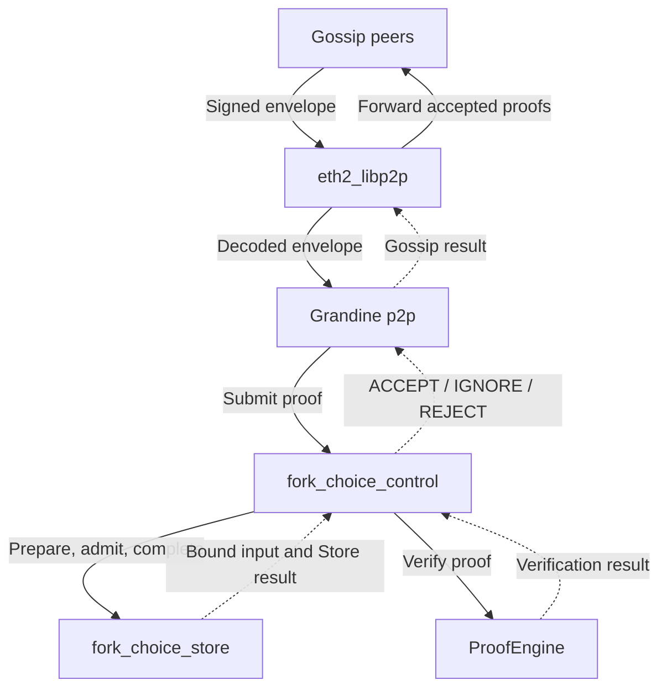
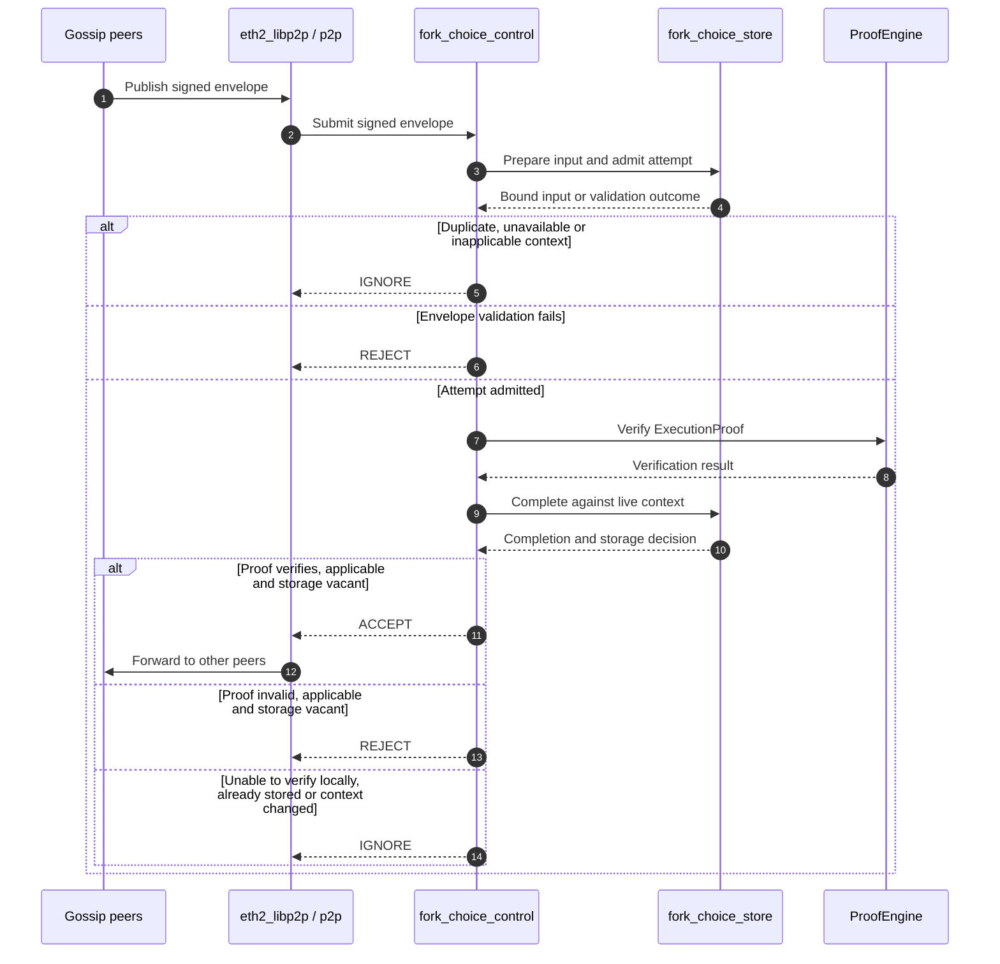

# Implementing EIP-8025 Optional Execution Proofs in Grandine

## Motivation

After more than three years without an increase, Ethereum resumed
raising its gas limit in February 2025, reaching 60 million gas and
signaling a broader shift toward scaling L1 execution. Today,
execution clients across the network independently repeat the same
computation to validate each execution payload, and the cost of this
duplicated work rises with the gas limit. The path toward gigagas
raises a fundamental question: how can Ethereum scale execution
without compromising the broad node participation that supports its
CROPS values?

Running a validator requires operating both a consensus client and an
execution client. These two services must be separately configured and
kept compatible, with coordinated upgrades during hard forks. The
execution client must also maintain the execution state required to
re-execute and validate each new payload, increasing compute and
storage requirements.

Execution proofs offer a way to support L1 scaling by replacing
re-execution with proof verification whose cost is largely independent
of the gas limit. They could allow consensus clients to validate
execution payloads—and even sync to the chain head—without relying on
a local execution client, reducing the operational burden of today's
two-client architecture. Realizing this model would require changes
primarily to the execution-payload validation path and to the
consensus-layer P2P protocols used to gossip proofs. This project
focuses on optional proof verification as a supplementary validity
signal, while preserving the existing execution-client validation
path.

## Project description

Optional Execution Proofs (EIP-8025) proposes to remove the
computational burden of transaction re-execution for every client node
via a simple and lightweight execution proof. An execution proof is a
cryptographic proof that guarantees a block's associated execution
payload is valid. Under this EIP, consensus clients will be
self-sufficient to perform block validations, node syncing,
attestations and fork-choice updates using execution proofs.
Meanwhile, execution clients will take on a critical and highly
specialized role of generating execution witnesses for these execution
proofs, creating a clean separation between consensus and execution.
This independence allows consensus clients to validate the chain on
their own from proofs propagated over the consensus-layer gossip
network, and to actively gossip newly received proofs once they have
verified them to be true.

A prover generates execution proofs and shares them with peers.
Whereas, a verifier (zkAttester) verifies these proofs and attests to
slots based on the validity of the associated proof. Both provers and
verifiers must be active validators to perform their duties. To enable
network statelessness for verifiers, a prover must maintain a fully
synchronized node comprising both the execution and consensus clients,
with the execution client natively executing blocks and packaging the
accessed state and bytecode into a self-contained execution witness
used to generate the proof. Concurrently, the consensus client acts as
a cryptographic coordinator, monitoring the beacon chain to trigger
proof generation, signing the resulting proof, and broadcasting it
across the network.

At the protocol level, this EIP introduces the `ProofEngine` as a new
abstraction operating alongside the traditional `ExecutionEngine`.
Grandine's verifier implementation uses `ProofEngine` for in-process
proof verification and public-input binding. Proof generation remains
the responsibility of external proving systems, while Grandine's
proof-processing pipeline coordinates validation and the fork-choice
Store manages accepted payload context and retained proofs.

The zkVMs infrastructure is not yet mature enough to be standardized
and support real-time proving. Therefore, EIP-8025 is fully optional
and straightforward to implement, requiring no hard fork since it does
not alter Ethereum's core consensus.

The immediate scope of this project is for Grandine consensus client
to successfully receive, validate and retain execution proofs. As
such, any execution client or Engine API integrations are currently
excluded from the core requirements and will only be pursued as
stretch goals.

This proposal targets the evolving draft of EIP-8025 and may require
adjustment as the specification evolves.

## Specification

### Scope and architecture

The core implementation will enable Grandine to receive, validate, and
retain EIP-8025 execution proofs generated by external proving
systems. The implementation includes SSZ representation and hashing,
accepted payload context resolution, signature verification,
cryptographic proof verification and binding, gossip reception and
propagation, proof-state management, and opt-in runtime configuration.
Proof distribution is gossip-based; Grandine implements no
EIP-8025-specific proof request/response protocol.

Within this scope, execution proof handling remains auxiliary to
Grandine's existing payload validation and fork-choice behavior. Proof
verification failures do not invalidate an execution payload that has
already been accepted through the existing Engine API flow.

Checkpoint proof synchronization, verified-head anchors, proof-driven
fork choice, physical pruning of proof state, dedicated resource
safeguards, and discovery or peering extensions are non-goals. Durable
proof-state persistence and proof generation are outside the core
scope.

The following table summarizes the responsibilities of the principal
components shown in the architecture.

| Component | Responsibility |
|-|-|
| `eth2_libp2p` | Handles the proof gossip topic, SSZ/Snappy transport, message-size bounds and forwarding after validation |
| Grandine `p2p` | Routes decoded proofs to the Controller and reports gossip validation outcomes to `eth2_libp2p` |
| `fork_choice_control` | Coordinates proof preparation, live admission, asynchronous verification and completion, and returns ACCEPT, IGNORE or REJECT |
| `fork_choice_store` | Resolves trusted payload context, provides authentication and binding helpers, and owns duplicate bookkeeping, applicability checks and retained proofs |
| `ProofEngine` | Verifies proofs in process using configured backends, checks committed public values against expected input, and returns a verification verdict |

### Data model and hashing

EIP-8025 introduces types for representing, binding and signing
execution proofs. The signed gossip envelope identifies the target
beacon block; the verifier reconstructs the expected public input
locally from that block's accepted payload context.

| Type | Purpose |
|-|-|
| `ProofType` | Identifies the proof system, guest program and version; represented as a byte, with support checked during validation |
| `ProofData` | Holds opaque proof bytes in a bounded SSZ byte list |
| `PublicInput` | Contains the payload-request root, successful-validation flag, chain ID and schema ID expected by the verifier |
| `ExecutionProof` | Combines proof bytes, proof type and locally constructed public input for submission to `ProofEngine` |
| `ExecutionProofEnvelope` | Carries proof bytes, proof type and the beacon-block root over gossip |
| `SignedExecutionProofEnvelope` | Wraps the envelope with the validator index and BLS signature |
| `NewPayloadRequest` | Represents the execution payload, versioned hashes, parent beacon-block root and execution requests used for binding |

The implementation supports SSZ serialization, deserialization and
hashing, including the progressive representations used by
`PublicInput`, `NewPayloadRequest` and its versioned hashes. The
proof-data bound affects its byte-list root; the limit on progressive
versioned hashes is enforced without entering their root.

Payload binding must agree with the proving stack. This area will
implement request-root computation and public-input binding in
alignment with the execution-layer and consensus-layer specifications,
and cross-check them against independent reference values.

An active validator signs the `ExecutionProofEnvelope`, producing the
`SignedExecutionProofEnvelope` exchanged through gossip. The bare
envelope's hash-tree root is reused for duplicate detection and as the
object root in the domain-separated BLS signing root. The local
`ExecutionProof` and its reconstructed public input are not the signed
gossip object.

### Proof reception, validation, and retention

The following sequence diagram illustrates the gossip-validation path.
The prover's internal generation and signing workflow is omitted
because it is outside the core project scope. The networking
participant combines `eth2_libp2p` and Grandine's `p2p` routing.
`fork_choice_control` coordinates the Store operations and calls
`ProofEngine` for in-process verification.

Preparation authenticates the envelope and derives expected input from
the accepted payload and its exact target state. Live admission checks
applicability and records both duplicate keys before expensive
verification. Completion checks the live context again and preserves
the first verified proof for each block and proof type. A local
inability to verify is IGNORED rather than treated as proof
invalidity. None of these outcomes changes ordinary payload
acceptance, beacon state or fork choice.

### Required changes by functional area

The identified EIP-8025 implementation gaps cut across six functional
areas:

#### Representation and hashing

| Gap | Likely implementation area |
|-|-|
| Proof types, envelopes and payload-request representation | `types` |
| SSZ encoding, bounds and hashing | `ssz` and `types` |

This area defines the proof containers and their SSZ representations,
including the locally constructed engine input and the signed gossip
envelope. It implements payload-request construction and hashing,
prover-compatible roots, and reference tests for the composed types.

#### Payload context and binding

| Gap | Likely implementation area |
|-|-|
| Resolve the accepted payload and exact target state | `fork_choice_store` |
| Construct trusted public input | `types` and `fork_choice_store` |

Grandine reconstructs the payload request from the accepted payload
envelope, its parent root and execution requests, and versioned hashes
derived from the target state's payload bid. It adds the successful-validation
flag, chain ID and schema ID to form the expected `PublicInput`.
Missing or inconsistent context causes a local IGNORE, rather than a
peer rejection. Preparation preserves the association between the
authenticated envelope and this trusted input.

#### Proof engine

| Gap | Likely implementation area |
|-|-|
| Verification interface and backend dispatch | `proof_engine` |
| Mock and genuine SP1 verification with public-input binding | `proof_engine` |

This area adds the `ProofEngine` verification interface and integrates
proof-system backends for cryptographic verification. Verification
must check that each proof binds to the expected public input.
Mock verification will support development and testing without
requiring proof generation.

Verification errors must be handled without disrupting ordinary
payload validation or treating local faults as evidence against a
gossip peer. Proof storage, duplicate bookkeeping and retention belong
to the Store and proof-processing pipeline.

#### Consensus-layer validation

| Gap | Likely implementation area |
|-|-|
| Ordered prechecks and envelope authentication | `fork_choice_store` and `helper_functions` |
| Asynchronous proof-processing orchestration | `fork_choice_control` |

Consensus-layer validation includes message bounds, supported-type
and duplicate checks, accepted payload context, validator eligibility
and domain-separated BLS signature verification. The Controller
coordinates preparation, live admission, engine execution and
completion. Expensive work runs off the Store's serialized mutation
path, and each incoming message receives a terminal gossip outcome.

#### Proof-state retention

| Gap | Likely implementation area |
|-|-|
| Duplicate bookkeeping and retained verified proofs | `fork_choice_store` |
| Live applicability and completion decisions | `fork_choice_store` and `fork_choice_control` |

The Store records authenticated attempts before verification and
retains the first verified envelope for each block and proof type.
Admission and completion require the block to remain retained with
matching accepted payload context. Late results cannot revive retired
targets or overwrite an existing proof. Logical retirement is separate
from physical cleanup; pruning and durable persistence are outside
the core scope.

#### Gossip, propagation and runtime configuration

| Gap | Likely implementation area |
|-|-|
| Proof gossip topic, pubsub message and SSZ/Snappy handling | `eth2_libp2p` |
| Routing and gossip validation feedback | `p2p` and `fork_choice_control` |
| Backend configuration, engine construction and opt-in subscription | `runtime`, `grandine` and `p2p` |

`eth2_libp2p` transports `SignedExecutionProofEnvelope` messages and
enforces the envelope-size bound before SSZ decoding. Grandine routes
them through the proof-processing pipeline and reports ACCEPT, REJECT
or IGNORE to gossipsub. Only ACCEPTed messages are forwarded.

Runtime configuration selects the backend and verification key for
each configured proof type, with SP1 support behind a non-default
build feature. Without an opt-in configuration, Grandine does not
perform execution-proof verification or subscribe to proof gossip.
Dedicated discovery and peering extensions are non-goals.

### Testing and interoperability

Daily development should not require generating execution proofs.
Testing will combine independent reference roots, zkboost-compatible
mock proofs and genuine execution-proof fixtures:

- **Verification and binding:** Test SSZ representations, bounds,
  signing roots and payload binding against reference values. Verify
  a genuine ethrex SP1 fixture with its committed public input and
  guest key, and test tampering, incorrect keys and input mismatches.
- **Processing and networking:** Test validation ordering, duplicate
  admission, concurrent completion, context changes and logical
  retirement. Exercise transport encoding, message-size limits,
  routing and opt-in subscription. Component tests cover
  local verification errors and unchanged behavior when verification is disabled.
- **Reproducible devnet demonstration:** Use a Kurtosis recipe and a
  controlled gossip publisher to exercise the released binary, runtime
  configuration, a live chain and the wire together. A matching mock
  proof must be authenticated, bound, verified, stored and forwarded
  to an observer. A second proof demonstrates already-verified
  handling. A genuine SP1 fixture for a different payload must pass
  cryptographic verification and then be rejected for a public-input
  mismatch; a tampered fixture must fail verification. Runs retain
  evidence sufficient to distinguish a pass, failure or inconclusive
  result caused by missing evidence or changing target eligibility.

The mock demonstration establishes pipeline integration; independent
reference roots provide the binding cross-check. Successful acceptance
of a genuine proof over gossip requires a compatible proof for the
target payload and is outside this devnet demonstration. Sepolia
readiness includes confirming the supported proof format, guest
verification key and public-input binding with the proving stack.

Because EIP-8025 is still an experimental and actively developing
standard, the available testing tools and fixtures are expected to
evolve and mature over time.

## Roadmap

The roadmap assumes two engineers working in parallel workstreams that
converge on a final joint milestone. It targets Sepolia readiness for
genuine execution-proof verification, while preserving existing
behavior for nodes that do not opt in.

<table>
  <thead>
    <tr>
      <th>Period</th>
      <th>Milestone</th>
      <th>Charles's Workstream</th>
      <th>Keshav's Workstream</th>
    </tr>
  </thead>
  <tbody>
    <tr>
      <td nowrap>
        Week 8 
        3–7 Aug
      </td>
      <td>
        Protocol baseline, proof representation and signing
      </td>
      <td>
        Proof types and envelopes, local public input and payload-request
        representation; SSZ encoding, hashing and reference tests
      </td>
      <td>
        Envelope BLS signing and domain separation; initial proof-engine,
        Controller/task and Store interfaces
      </td>
    </tr>
    <tr>
      <td nowrap>
        Weeks 9–11 
        10–28 Aug
      </td>
      <td>
        Trusted payload binding and authenticated preparation
      </td>
      <td>
        Payload-request reconstruction and root computation;
        prover-compatible hashing and independent reference roots
      </td>
      <td>
        Exact target-state and accepted-payload resolution; ordered
        prechecks, validator eligibility, BLS authentication and
        protected proof preparation
      </td>
    </tr>
    <tr>
      <td nowrap>
        Weeks 12–14 
        31 Aug–18 Sep
      </td>
      <td>
        Verification backends and Store lifecycle
      </td>
      <td>
	    ProofEngine verification interface; mock and genuine proof
        verification, public-value binding and verification error handling
      </td>
      <td>
        Live admission, atomic duplicate bookkeeping, accepted-context
        checks, first-valid storage and logical retirement
      </td>
    </tr>
    <tr>
      <td nowrap>
        Weeks 15–16 
        21 Sep–2 Oct
      </td>
      <td>
        Gossip transport and proof-processing orchestration
      </td>
      <td>
        Opt-in eth2_libp2p proof transport, typed pubsub messages,
        SSZ/Snappy handling, size bounds and transport tests
      </td>
      <td>
        Connect preparation, admission, asynchronous engine verification
        and completion; terminal validation outcomes and concurrent-path
        tests
      </td>
    </tr>
    <tr>
      <td nowrap>
        Weeks 17–19 
        5–23 Oct
      </td>
      <td>
        Runtime/network integration and demonstration tooling
      </td>
      <td>
        Runtime backend/key configuration and SP1 build support;
        gossip publisher, observer and reproducible devnet recipe
      </td>
      <td>
        Adopt the transport revision; route proofs to the Controller,
        derive subscription from engine opt-in, return gossip feedback
        and test disabled behavior
      </td>
    </tr>
    <tr>
      <td nowrap>
        Weeks 20–22 
        26 Oct–13 Nov
      </td>
      <td>
        Integrated demonstration and Sepolia readiness
      </td>
      <td colspan="2">
        Demonstrate the integrated pipeline on a devnet; confirm
        Sepolia prover-format, guest-key and public-input compatibility;
        resolve specification-alignment issues and verify default-off
        behavior
      </td>
    </tr>
  </tbody>
</table>

Stretch goals include additional verification backends, a production
prover publication workflow, and durable persistence of proof state.

## Possible challenges

Following are the hurdles and limitations we might need to overcome:

- **Evolving specifications:** EIP-8025 and its execution-layer and
  consensus-layer specifications may change substantially during the
  project. Proof retrieval may leave scope, and SSZ representations,
  supported proof types and public-input commitments may change.
  Maintaining agreement between the specifications and the proving
  stack is essential for successful verification.
- **Prover interoperability:** Proof codecs, guest programs and
  verification keys must agree across implementations. A valid proof
  can fail locally if Grandine constructs a different payload
  commitment or uses an incompatible guest key. Genuine fixtures and
  independent binding vectors are needed alongside mock tests.
- **Resource costs:** Execution proofs can be up to 4 MiB, and BLS
  checks and zkVM verification add CPU and memory costs. Message-size
  bounds, ordered prechecks and duplicate admission reduce avoidable
  work, but dedicated rate limits, queue/concurrency caps and physical
  pruning are outside the core project scope.
- **Concurrent validation:** Workers can prepare proofs from stale
  Store snapshots. Duplicate admission and completion must remain
  correct when proofs overlap, payload context changes, or finalization
  retires the target block.
- **Testing and fixtures:** A reproducible Gloas devnet must combine
  the client binary, runtime configuration, accepted payloads and
  signed gossip. Mock proofs simplify daily testing, but genuine
  fixtures and explicit negative controls are needed to establish
  real verifier integration.
- **Optional behavior:** Proof failures and local verification faults
  must not change existing payload validity or fork choice. Nodes
  that do not opt in must retain their existing startup, networking
  and validation behavior.

## Goal of the project

The project has two primary objectives:

1. Prepare Grandine to successfully verify genuine execution proofs
   on Sepolia.
2. Preserve existing behavior for nodes that have not opted in to
   execution-proof verification.

Supporting capabilities are:

- Receive signed execution-proof envelopes over gossip when enabled,
  and return ACCEPT, REJECT or IGNORE outcomes consistently.
- Authenticate envelopes, suppress duplicate attempts and derive
  trusted public input from accepted execution payload context.
- Verify genuine SP1 proofs and enforce payload binding, while
  distinguishing proof invalidity from local inability to verify.
- Retain verified proofs for applicable targets without changing
  payload validity, beacon state or fork choice.
- Demonstrate the running pipeline with mock acceptance, genuine SP1
  verification followed by binding rejection, and a tampering control.

## Collaborators

### Fellows

[Keshav](https://github.com/keshavsharma25) 
[Charles](https://github.com/creese)

## Resources

- [EIP-8025 presentations, design notes, and updates](https://frisitano.github.io/slides/index.html#eip-8025)
- Gigagas L1 technical deep dive (Ethproofs Call #3): [video](https://www.youtube.com/watch?v=D2TpmD62tjQ&t=2980s) and [slides](https://docs.google.com/presentation/d/1IVpbyxdRLCik2vBE9-6EMIW-FWvjWm5YmgzfXTzsBU0/edit?slide=id.g36e7baa00a1_0_1179#slide=id.g36e7baa00a1_0_1179)
- [Justin Drake's zkEVM attesting keynote and demo](https://www.youtube.com/watch?v=BUuNcXiaH3U&t=2s)
- [Grandine Ethereum consensus client](https://github.com/grandinetech/grandine)
- [Grandine P2P networking stack (eth2_libp2p)](https://github.com/grandinetech/eth2_libp2p)
- [EIP-8025 draft specification](https://eips.ethereum.org/EIPS/eip-8025)
- [EIP-8025 consensus-layer specifications](https://github.com/ethereum/consensus-specs/tree/master/specs/_features/eip8025)
- [Grandine EIP-8025 designs](https://github.com/eip8025-grandine/design)
- [Grandine EIP-8025 implementation](https://github.com/eip8025-grandine/grandine)
- [Grandine EIP-8025 gossip transport](https://github.com/eip8025-grandine/eth2_libp2p)
- [Lighthouse EIP-8025 implementation (PR #39)](https://github.com/eth-act/lighthouse/pull/39/changes?mode=single#diff-ba8ded80a934554c0f26af27a7e910c5b15a03c97f72accd9cbaaaad7f645418)
- [ethrex EIP-8025 implementation notes](https://github.com/lambdaclass/ethrex/blob/834733eb0a343238b2357dc4be19c3859af93f7d/docs/eip-8025.md)
