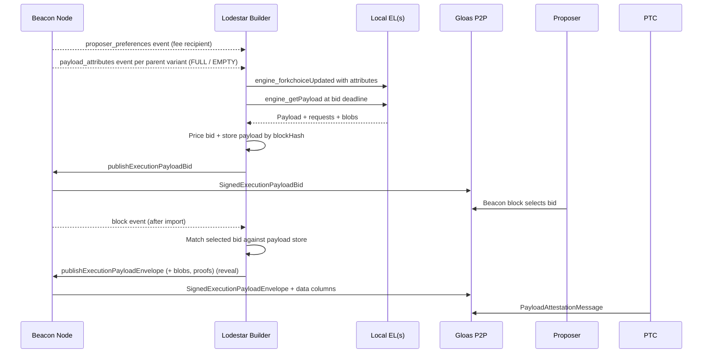
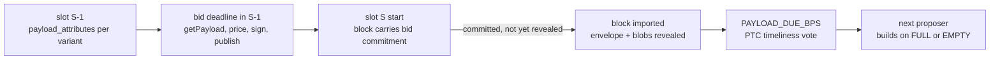
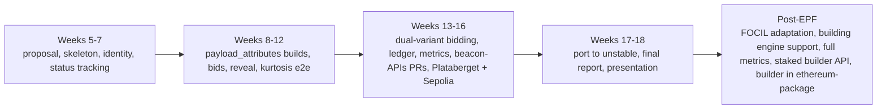

# Lodestar EIP-7732 Builder Proposal

Build an honest-path `lodestar builder` for EIP-7732 / Gloas: a Lodestar-native builder client that builds execution payloads on local execution clients and/or a dedicated building engine, publishes signed p2p bids, detects when one of its bids is selected, and reveals the matching payload envelope.

> **Status (October 2026).** The builder is implemented as the `@lodestar/builder` package, verified end to end on a kurtosis devnet, and running on the Sepolia testnet where it bids, wins slots, and reveals payloads. This proposal is updated to reflect the decisions made during implementation; the original plan is preserved in the repository history.

## Motivation

Ethereum block production already relies heavily on proposer-builder separation, but today's production PBS flow depends on extra-protocol relay infrastructure between validators and builders -- a trusted intermediary sitting in the protocol's most valuable path.

[EIP-7732](https://eips.ethereum.org/EIPS/eip-7732), enshrined proposer-builder separation or ePBS, moves that exchange into the protocol. Instead of including the full `ExecutionPayload` directly in the beacon block, the beacon block carries a signed builder commitment, `SignedExecutionPayloadBid`. The builder later reveals the matching payload through a `SignedExecutionPayloadEnvelope`, and Payload Timeliness Committee members attest whether the payload and blob data were revealed in time.

This project implements the missing Lodestar-side builder for that lifecycle. The [EPF7 project board](https://github.com/eth-protocol-fellows/cohort-seven/blob/main/projects/project-ideas.md#lodestar-eip-7732-builder) describes it as an in-protocol `lodestar builder` under EIP-7732 for Glamsterdam that will submit p2p bids every slot based on locally produced payloads from execution-layer software such as Nethermind or Ethrex or a dedicated building engine, publish the payload if it wins, and pay the proposer through trustless payment. The purpose of this project is also exploratory. In other words, we aim to find spec gaps that need to be resolved for a consensus client to cleanly act as a builder.

Prior EPF cohorts implemented the consensus side of ePBS in Prysm, Nimbus, and Lighthouse, all centered on the spec and the self-build path. Outside the clients, ethpandaops shipped [buildoor](https://github.com/ethpandaops/buildoor), a standalone builder+relay with an ePBS mode used for devnet lifecycle testing. What Lodestar did not have is a consensus-client-native builder actor. That is where this project sits, with buildoor as a reference implementation and interop peer.

Lodestar already had much of the Gloas infrastructure when the project started. Types, gossip topics, proposer-preference plumbing, bid validation, bid-pool logic, self-build paths, envelope validation, PTC logic, and builder registry work already existed in Lodestar. The missing piece was the external builder loop itself.

FOCIL / Heze and Deathstar were scoped context rather than parallel deliverables: the FOCIL / Heze adaptation is deferred to after the fellowship, and the builder-specific adversarial work was dropped in favor of builder work and Glamsterdam devnet testing.

## Project description

The project implements and documents an honest-path `lodestar builder` for EIP-7732 / Gloas. The builder consumes payload attributes and proposer preferences from a beacon node, builds a payload candidate on one or more local execution clients over the Engine API or a dedicated building engine, constructs and signs an `ExecutionPayloadBid`, publishes the resulting `SignedExecutionPayloadBid`, keeps the exact payload material committed to by the bid, detects whether the bid was selected in an imported beacon block, and reveals the matching `SignedExecutionPayloadEnvelope`.

The builder is a separate client, shaped like the validator client: duties are derived from the clock and beacon node events, decisions are one-shot, and the builder owns the key, the pricing, and the payload material it has bid on. The beacon node keeps its role unchanged (it syncs the execution client, emits events, validates and gossips bids and envelopes) and the execution clients only build payloads.

The baseline bid policy is a proportional share of the payload value minus a fixed cost, bounded by configured minimum and maximum values and by the balance the builder can actually cover. The builder always broadcasts: bids cost nothing unless they win, bidding is one-shot, and the local view of competing bids is partial and late, so competing bids are never a decision input. `BidPolicy` is an interface, so other strategies (including competitor-aware ones) can be plugged in without changing the builder loop.

The authoritative description of the architecture, per-slot flow, pricing, invariants, and open questions is present in the [design document](https://github.com/ChainSafe/lodestar/blob/99fd8fa9ad3a867fced3a5907a68edf3a519c1cd/packages/builder/DESIGN.md). A companion [living technical note](https://hackmd.io/@krisos/S1a9mdB7fl) tracks the earlier code-path maps and PR state.

**Scope summary**

| Area | Role in this project |
| --- | --- |
| Core project | Implement the missing Lodestar Builder loop for EIP-7732 / Gloas (done) |
| First success target | Local bid -> selection -> reveal demo (done on Kurtosis, Plataberget & Sepolia) |
| Spec work | beacon-APIs changes needed for an external builder (see [Spec Improvements](#spec-improvements)) |
| Follow-ups | Heze / FOCIL adaptation pass, dedicated building engine support, full metrics, staked builder API, Lodestar builder in `ethereum-package` |
| Dropped | builder-specific Deathstar scenarios |

## Specification

EIP-7732 removes the direct execution payload, blob commitments, and execution requests from the beacon block body; the body instead carries a `signed_execution_payload_bid` and payload attestations, with the full payload revealed later through a signed envelope. The [Gloas honest-builder spec](https://github.com/ethereum/consensus-specs/blob/d9663f85be248c4fd0ae95806da6070e17c2442b/specs/gloas/builder.md) describes the builder as a staked actor that submits bids and later submits payloads; accepted bids commit the builder to pay the proposer whether or not the payload is submitted. The [p2p spec](https://github.com/ethereum/consensus-specs/blob/d9663f85be248c4fd0ae95806da6070e17c2442b/specs/gloas/p2p-interface.md) defines the gossip surface (`execution_payload_bid`, `execution_payload`, `payload_attestation_message`, `proposer_preferences`) and its validation rules.

On the Lodestar side, the code could already produce a block with a provided builder bid, and the self-build path constructs a bid with `BUILDER_INDEX_SELF_BUILD` (defined as `Infinity` in `packages/params`). The gap was the external builder: an actor that owns a builder key, observes preferences, builds a payload, signs and publishes a bid, remembers the exact payload package the bid commits to, detects a win, and reveals the envelope.

The protocol constraints the design is built around:

- **A bid commits to a fully built payload.** `blockHash`, `blobKzgCommitments`, `executionRequestsRoot` and `gasLimit` are part of the bid, so the EL build must finish before bidding. The envelope only adds `beaconBlockRoot`, so the reveal is assembly plus signature.
- **Parent binding.** A bid for slot S builds on either the head's delivered payload (FULL) or the head's execution parent (EMPTY). Nodes only forward the variant their own view selects, so the builder bids on both.
- **One bid per `(slot, parentBlockHash, parentBlockRoot, builder)`.** Bids cannot be updated and must exceed the best bid seen by a minimum increment to be forwarded.
- **Proposer preferences gate bidding.** `bid.feeRecipient` must equal the proposer's fee recipient and `bid.gasLimit` must be compatible with `targetGasLimit`.
- **Economics.** `bid.value` is paid from the builder’s consensus balance as a pending payment, released at epoch end only if the block that included the bid gathers enough attestation weight; builder revenue is EL tips and MEV sent to the coinbase.

How the open design questions from the original proposal were resolved:

| Question | Decision |
| --- | --- |
| Where does the builder live? | Standalone `@lodestar/builder` package and `lodestar builder` command, not a beacon-node service. |
| Where do payload inputs come from? | The beacon node's `payload_attributes` event (`parentBlockRoot`, `parentBlockHash`, `prevRandao`, `withdrawals`, `timestamp`, `targetGasLimit`), emitted per parent variant. The builder deduplicates by `(slot, parentBlockHash)`. |
| Where do proposer preferences come from? | The `proposer_preferences` event, plus a fetch of pooled preferences on event-stream connection. |
| How is `target_gas_limit` passed per payload? | The builder calls `engine_forkchoiceUpdated` with payload attributes directly on each execution client, per build, and `engine_getPayload` at the bid deadline. |
| Which payload source? | Any Engine API execution client, or a dedicated building engine behind the same `PayloadSource` interface; multiple `--execution.urls` are multiple payload sources and the highest-value payload per variant wins. |
| Bid signing | Added to the builder signer alongside envelope signing. |
| Bid -> payload cache | `PayloadStore` keyed by `blockHash`, holding payload, execution requests, blobs and proofs, pruned by slot. Never sign a bid for a `blockHash` not in the store. |
| Reveal timing | Reveal on the `block` event, after `on_block` and the full state transition, not on `block_gossip`. The reveal uses the stateless `publishExecutionPayloadEnvelope` flow, so it works through any beacon node and survives beacon node restarts. |
| Winning-bid detection | `block` event; with [beacon-APIs #641](https://github.com/ethereum/beacon-APIs/pull/641) it carries `builder_index` and `block_hash`, so no block fetch is needed. |
| Bid policy | Proportional: `value = clamp(floor(payloadValue * shareBps / 10_000) - fixedCost, minValue, maxValue)`, skipped if above the coverable balance (`balance - MIN_DEPOSIT_AMOUNT - unsettled won bids`). |
| Equivocating proposer | Reveal for every distinct block root that commits to the bid; the envelope is bound to the block root. |

Further invariants enforced by the builder's ledger: never submit the same `(slot, parentBlockHash, parentBlockRoot)` tuple twice; never sign two different envelopes for the same `beaconBlockRoot`; stop bidding when the builder status is `exited` or the balance drops below the operating minimum. `publishExecutionPayloadBid` returning `BID_TOO_HIGH` is the safety net for the coverable-balance estimate.

## Spec Improvements

The exploratory half of the project produced the following beacon-APIs changes. All were needed for a consensus-client-external builder that drives the Engine API itself.

| Change | Why a builder needs it |
| --- | --- |
| [#638](https://github.com/ethereum/beacon-APIs/pull/638) `safe_block_hash` / `finalized_block_hash` on the post-Gloas `payload_attributes` event | `engine_forkchoiceUpdated` needs a full `ForkchoiceStateV1`; post-Gloas the justified and finalized execution hashes depend on payload delivery, which is not observable through the beacon API |
| [#655](https://github.com/ethereum/beacon-APIs/pull/655) `builder_pending_withdrawals` and `builder_pending_payments` state endpoints | Sizing bids against unsettled payments and pending withdrawals |
| [#659](https://github.com/ethereum/beacon-APIs/pull/659) proposer preferences endpoint | A builder that starts mid-epoch misses preferences gossiped before it subscribed to the event stream |
| [#641](https://github.com/ethereum/beacon-APIs/pull/641) builder bid identity (`builder_index`, `block_hash`) on the `block` event | Deciding whether to reveal without a block fetch per imported block |
| [#643](https://github.com/ethereum/beacon-APIs/pull/643) remove `GET /eth/v1/validator/execution_payload_bids/{slot}/{builder_index}` | Dead endpoint under the final bid flow |
| [#637](https://github.com/ethereum/beacon-APIs/pull/637) clarify `Eth-Builder-Url` response header | Builder API wording |
| [#628](https://github.com/ethereum/beacon-APIs/pull/628), [#629](https://github.com/ethereum/beacon-APIs/pull/629) `head_v2` emission semantics | Found while implementing `head_v2` in Lodestar and comparing cross-client behavior |
| [#668](https://github.com/ethereum/beacon-APIs/pull/668) make gossip validation on `POST /eth/v1/beacon/execution_payload_bids` optional | The operator's own builder may bid on a branch the beacon node is not on; the validation rules exist to limit forwarding of peers' bids |

## Roadmap

**Done.**

- Builder skeleton: identity resolution, readiness gating, signer, `BuilderStatusTracker` with epoch-clock polling, CLI and metrics wiring.
- Phase 1: `payload_attributes` driven builds against local execution clients, fixed-share bid policy, reveal via stateless envelope publish, unconditional flood-published API bid publishing in the beacon node.
- Phase 2: remaining beacon node follow-ups (event-driven per-variant attributes, forkchoice hashes on the event, bid identity on the `block` event), dual-variant bidding, ledger, metrics, multiple ELs with max-value selection.
- Verified end to end on a two-node kurtosis devnet, then run on the Plataberget devnet and on Sepolia, where the builder is bidding, winning slots and revealing payloads.
- beacon-APIs changes listed under [Spec Improvements](#spec-improvements).
- Nightly kurtosis e2e test on `unstable` running the Lodestar builder, validator and beacon node and asserting bids, wins and reveals.
- The builder is present on `unstable` with a minimal wiring ([ChainSafe/lodestar#10379](https://github.com/ChainSafe/lodestar/pull/10379)), with proposer preference retrieval on event-stream connection ([#10290](https://github.com/ChainSafe/lodestar/pull/10290)), forkchoice hashes on the `payload_attributes` event ([#10243](https://github.com/ChainSafe/lodestar/pull/10243)) and optional validation on API bid publishing ([#10429](https://github.com/ChainSafe/lodestar/pull/10429)) on the beacon node side.

**Finalization (weeks 17-18).** Finish the final EPF reports, and present the project on November 4th.

**Follow-ups after EPF.** The Heze / FOCIL adaptation pass; building payloads on a dedicated building engine next to execution clients (in progress, led by Nico); full metrics and the staked builder API as separate PRs on top of the wiring PR; getting the Lodestar builder into `ethereum-package`; the parent-of-head variant for proposer-boost reorg slots and reveal redundancy across beacon nodes.

## Possible challenges

**Evolving EIP-7732 / Gloas specs.** Gloas is still draft, and builder-adjacent containers, deadlines, signing roots, and API surfaces may move during the cohort. The builder should keep bid construction, signing, cache keys, and reveal logic modular enough to follow those changes.

> *Outcome:* They did move, most visibly the SSZ engine work in Lodestar, which invalidated an earlier round of builder PRs and led to the builder being ported to `unstable` in a single minimal wiring PR.

**Builder service boundary.** The cleanest home for `lodestar builder` is not obvious; the first prototype may need to live near existing beacon-node or validator-client services to reuse code.

> *Outcome:* Resolved as a standalone client (see the decisions table above); the residual cost is a second `forkchoiceUpdated` writer on the execution client next to the beacon node, and EMPTY-variant builds moving the EL head back one payload until the next `forkchoiceUpdated`.

**Builder identity, registration, and balance.** Builders onboard through dedicated EIP-8282 deposit/exit request contracts (deposits carry inline-verified proofs of possession; exits are authorized by the builder's execution address), need active status and excess balance covering bids plus pending payments. Registration must be reproducible on a devnet, and deposit-signature verification is a known performance surface ([Lodestar #9436](https://github.com/ChainSafe/lodestar/pull/9436)).

> *Outcome:* Reproducible on kurtosis once we learned that `builder_count` in `ethereum-package` only funds the key and the EIP-8282 deposit still has to be made; balance tracking became `BuilderStatusTracker` plus the [#655](https://github.com/ethereum/beacon-APIs/pull/655) pending-payment endpoints.

**Payload cache correctness.** The exact bid -> payload mapping must survive to reveal; misses and mismatches fail closed. Recent envelope-cache and idempotency PRs show this path has real resource and correctness edge cases.

> *Outcome:* `PayloadStore` keyed by `blockHash`; a bid is never signed for a `blockHash` that is not in the store, so a won bid can always be revealed. No mismatch has been observed on devnets or Sepolia.

**Timing and PTC visibility.** The reveal must beat the payload deadline for the PTC -- and, since [consensus-specs #5210](https://github.com/ethereum/consensus-specs/pull/5210), a late payload is forcibly reorged by the next proposer. Local success may not imply devnet success under real propagation.

> *Outcome:* The real squeeze was build time, not reveal time -- solved by event-driven per-variant `payload_attributes` emission in the beacon node.

**Bid policy.** Fixed-value is enough for the honest path, but a stronger builder eventually needs payload value, competing bids, balance constraints, canonical-inclusion risk, and free-option incentives -- an unbounded research surface kept behind the extension gate.

> *Outcome:* Shipped behind the `BidPolicy` interface; competing bids deliberately excluded from the baseline.

## Goal of the project

The project is successful if Lodestar has a working, tested, and documented honest-path EIP-7732 builder prototype.

**Minimum success (done):**

- Builder command skeleton with configuration and key-handling design.
- Proposer-preference lookup, local payload construction, bid construction/signing/p2p publication, bid -> payload cache, winning-bid detection, and envelope construction/signing/publication.
- Core bid/reveal-path tests and documentation of spec gaps, Lodestar gaps, and devnet assumptions.

**Strong success (done unless noted):**

- Reproducible end-to-end demo with real local execution clients.
- Configurable bid policy plus bid/win/reveal/timing logs and metrics.
- Dual-variant payload preparation: bid on both the FULL and the EMPTY parent, with builds started as soon as each variant becomes buildable ([see more](https://github.com/eth-protocol-fellows/cohort-seven/pull/161#discussion_r3574786863)).
- Beacon-APIs changes merged ([Spec Improvements](#spec-improvements)); Lodestar builder PRs merged and in review.
- Final write-up of what existed, what was added, and what remains.
- Server-side of the builder API and serving trustless bids via API -- follow-up.
- Heze / FOCIL adaptation pass -- deferred: FOCIL is not in the Glamsterdam set, planned post-fellowship.

**Stretch success:**

- Improved bid policy beyond a fixed constant -- done (proportional policy with cost, bounds and balance coverage).
- Run a kurtosis devnet with the Lodestar builder alongside buildoor and win slots -- done; "consistently out-bid buildoor" was dropped as a goal since the design ignores competing bids.
- Deeper write-up of builder bidding constraints under ePBS -- done, as the pricing, invariants and open-questions notes that ship with the builder package.
- ~~Builder-adversarial Deathstar matrix~~ -- not pursued.
- ~~Envelope withholding research~~ -- not pursued for now.

## Running Proof

- Builder page on Sepolia: https://light-sepolia.beaconcha.in/builder/0 (actively bidding at the time of this proposal update)
- Example of a slot where our builder won: https://light-sepolia.beaconcha.in/slot/11335049 (see `Block Extra Data`)
- Code: https://github.com/ChainSafe/lodestar/tree/unstable/packages/builder

## Collaborators

### Fellows

- [Kris O'Shea](https://github.com/krisoshea-eth)
- [Marko Lazic](https://github.com/markolazic01)

<!-- TODO: link both fellows' final EPF updates once published -->

### Mentors

- [Nico Flaig](https://github.com/nflaig) -- Lodestar (ChainSafe); co-author of EIP-7732 (ePBS).

### Helpers

- [Lodekeeper](https://github.com/lodekeeper) -- Lodestar's main AI helper.

## Resources

- **[Builder design document](https://github.com/ChainSafe/lodestar/blob/99fd8fa9ad3a867fced3a5907a68edf3a519c1cd/packages/builder/DESIGN.md)** -- architecture, slot timeline, per-slot flow, pricing, invariants, beacon node follow-ups, open questions, and proposed beacon-APIs changes
- **[Living technical note](https://hackmd.io/@krisos/S1a9mdB7fl)** -- companion document with the earlier code-path map, PR map, and resource library
- **[Presentation slides](https://docs.google.com/presentation/d/1cmC3fpu652gZFTIm2_P1lIYOfC2M_w3c5qXSUZ4B6lc)** -- Lodestar EIP-7732 Builder project presentation
- [EIP-7732](https://eips.ethereum.org/EIPS/eip-7732) - Gloas [builder](https://github.com/ethereum/consensus-specs/blob/d9663f85be248c4fd0ae95806da6070e17c2442b/specs/gloas/builder.md) and [p2p](https://github.com/ethereum/consensus-specs/blob/d9663f85be248c4fd0ae95806da6070e17c2442b/specs/gloas/p2p-interface.md) specs - [EIP-7773 (Glamsterdam meta)](https://eips.ethereum.org/EIPS/eip-7773) - [EIP-8282 (builder deposits/exits)](https://eips.ethereum.org/EIPS/eip-8282)
- EPF7 project ideas: [Builder](https://github.com/eth-protocol-fellows/cohort-seven/blob/main/projects/project-ideas.md#lodestar-eip-7732-builder) - [Deathstar](https://github.com/eth-protocol-fellows/cohort-seven/blob/main/projects/project-ideas.md#lodestar-adversarial-node)
- [Lodestar](https://github.com/ChainSafe/lodestar) - [`@lodestar/builder`](https://github.com/ChainSafe/lodestar/tree/99fd8fa9ad3a867fced3a5907a68edf3a519c1cd/packages/builder) - wiring PR [#10379](https://github.com/ChainSafe/lodestar/pull/10379) - [Deathstar chaos catalog](https://github.com/ChainSafe/lodestar/blob/2e06376dcd7a804bb824a2262809bfcfabdda645/EPBS_CHAOS_FEATURES.md)
- [buildoor](https://github.com/ethpandaops/buildoor) - [ethereum-package](https://github.com/ethpandaops/ethereum-package)
- [Why enshrine PBS?](https://ethresear.ch/t/why-enshrine-proposer-builder-separation-a-viable-path-to-epbs/15710) - [PTC: an ePBS design](https://ethresear.ch/t/payload-timeliness-committee-ptc-an-epbs-design/16054) - [The Free Option Problem in ePBS](https://collective.flashbots.net/t/the-free-option-problem-in-epbs/5115) - [Who Wins Ethereum Block Building Auctions and Why?](https://drops.dagstuhl.de/entities/document/10.4230/LIPIcs.AFT.2024.22) - [Block vs. Slot Auction PBS](https://mirror.xyz/julianma.eth/CPYI91s98cp9zKFkanKs_qotYzw09kWvouaAa9GXBrQ) (Julian Ma)
